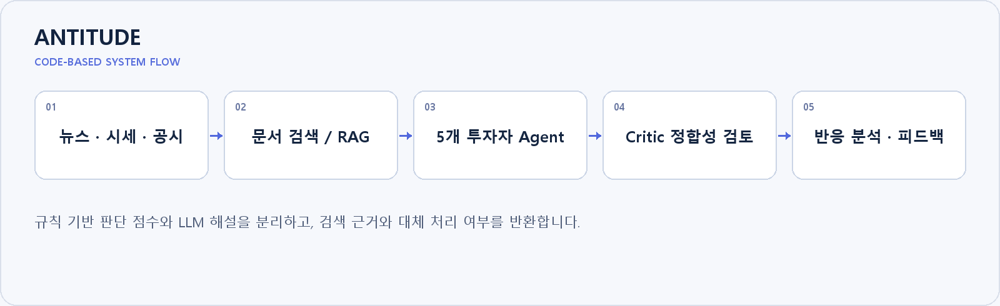

# ANTITUDE

**공시 검색과 투자자 Agent를 연결한 투자 판단 학습 플랫폼**

사용자가 뉴스와 시세를 보고 판단 근거를 작성한 뒤, 여러 투자자 관점과 자신의 판단을 비교하는 금융 교육 서비스입니다.

2026.03 - 진행 중 | 5인 팀장 | AI 활용 흐름 기획 · 웹/API 개발 · 기능 통합  
`Python · FastAPI · React · TypeScript · MongoDB · Ollama · FAISS · KIS API`

## 본인 기여

투자자 Agent, 공시 기반 RAG, 판단 학습 피드백의 목적과 전체 흐름을 기획했습니다. 웹 화면과 API를 개발하고 팀이 구현한 AI 모듈을 서비스에 통합했습니다.

## 기술 구조

| 구성 | 구현 내용 |
|---|---|
| 역할별 Agent 병렬 실행 | 개인·기관·외국인·단기·장기 투자자에게 서로 다른 시스템 프롬프트를 적용합니다. asyncio.gather로 5개 반응을 생성하고 매수·매도·관망, 이유와 위험 요인을 JSON으로 받습니다. |
| 기업 공시 기반 RAG | DART·SEC EDGAR 문서를 청크로 나누고 Ollama 임베딩을 MongoDB에 저장합니다. 종목별 FAISS 인덱스를 메모리에 올려 관련 문서를 검색하고 LLM의 분석 맥락으로 제공합니다. |
| 검토와 실패 처리 | Critic은 관점 차이와 논리적 모순을 구분합니다. 단계별 호출 실패 시 해당 단계만 규칙 처리로 대체하고, 사용 근거·불확실성·fallback 여부를 응답에 포함합니다. |
| 채점과 코칭의 분리 | 시나리오 점수는 규칙으로 계산하고 Gemini는 채점 재료에 근거한 해설을 작성합니다. 이전 조언을 다음 턴에서 반영했는지 추적하되 중복 감점에는 사용하지 않습니다. |

## 구현 결과와 확인 범위

뉴스·시세·공시와 Agent 분석을 하나의 학습 흐름으로 통합했습니다. 관련 RAISE 연구에 제2저자로 참여했고, 전역자금 플래너 확장 버전으로 해커톤 총장상을 받았습니다.

현재 코드의 RAG·Agent 구현과 수상 논문의 연구 범위는 구분합니다. 화면의 신뢰도·반응 압력은 실제 주가 예측 확률로 검증된 값이 아닙니다.

## 코드와 실행

[Agent 실행](simulator/market_reaction/app/core/agents.py) · [RAG 검색](simulator/market_reaction/app/services/document_retrieval.py) · [Critic](simulator/market_reaction/app/core/critic.py) · [규칙 채점](services/scenario-server/scoring/engine.py) · [클라이언트 API](app/src/services/judgment.service.ts)

전체 서비스별 설치와 실행, 환경변수, 실험 기록은 [기술 문서](README_DETAILS.md)를 참고합니다. 실제 시세·DB·LLM 연결은 각 서비스의 설정이 필요합니다.

화면·구성도는 설명을 위한 자료이며, 구성도는 현재 코드의 처리 흐름을 정리한 것입니다. 실험 수치와 본인 기여 범위는 위에 명시한 기준으로 해석합니다.
